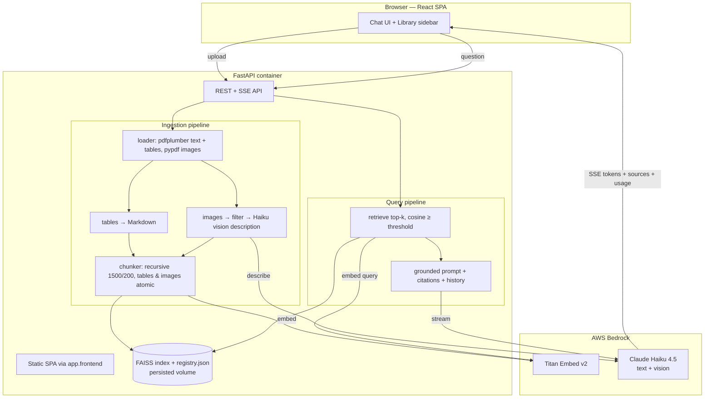

# Architecture

One container, two pipelines.

## Request flows

**Ingestion** (`POST /api/documents`): file → per-page extraction (prose via
pdfplumber, tables converted to Markdown, embedded images via pypdf) → small
images filtered out → remaining images described by Haiku vision → everything
chunked (prose split recursively at ~1500 chars / 200 overlap; tables and image
descriptions kept atomic) → embedded with Titan v2 → stored in FAISS with
`{doc_id, filename, page, content_type, chunk_index}` metadata → index +
registry persisted to the Docker volume.

**Query** (`POST /api/chat`, SSE): question embedded → top-5 cosine search with
a relevance floor (0.15, calibrated empirically) → if nothing passes, a
deterministic "not found" answer is returned **without an LLM call** → else the
chunks become numbered context blocks in a grounded system prompt (plus the
last 6 trimmed history turns) → Haiku streams the answer → the client receives
`sources` (citations with scores), `token` fragments, and a final `done` event
with token counts and estimated cost.

## Why one container

FastAPI serves the built React app itself (`app.frontend("/", directory=...)`,
API routes take priority, unknown paths fall back to `index.html`). No nginx,
no CORS, one port, one image — the right amount of infrastructure for this
scope. The production section of the README describes how this splits apart
when it needs to scale.
